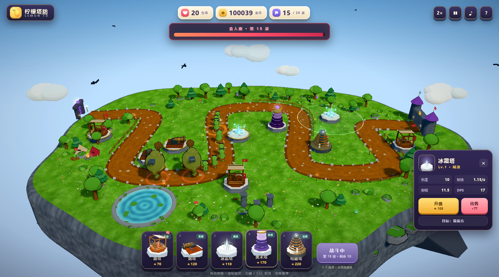

# 柠檬塔防 · LEMON TD

一个卡通风格的 3D 塔防游戏。纯 Three.js 程序化建模，没有外部模型 / 贴图 / 音频资源 —— 打开浏览器就能玩。



## 快速开始

```powershell
cd E:\development\lemon-td
npm install
npm run dev
# http://127.0.0.1:5188
```

生产构建：

```powershell
npm run build
npm run preview   # http://127.0.0.1:5189
```

## 附带的可复用 Skill

`skill/` 里是从这个项目沉淀出来的技能 **`threejs-cartoon-game`**：Three.js 卡通 3D 游戏的渲染管线、程序化建模、玩法架构、音效合成、截图 QA 全套经验与踩坑清单。

- 目录版：`skill/threejs-cartoon-game/`
- 打包版：`skill/threejs-cartoon-game.skill`
- 安装：把目录复制到 `~/.agents/skills/`，或在支持 `.skill` 的环境里直接导入。

## 玩法

敌人从左侧紫色传送门出生，沿 S 形小路冲向右侧城堡。在草地上建塔拦截，漏怪扣生命，生命归零失败。

| 操作 | 说明 |
| --- | --- |
| `1`–`5` / 点卡片 | 选择防御塔 |
| 点草地 | 建造（悬停时有半透明预览与射程圈） |
| 点已建塔 | 查看属性 / 升级 / 出售 / 切换目标优先级 |
| 拖动 / 滚轮 | 旋转 / 缩放视角 |
| `空格` | 暂停 |
| `F` | 1× / 2× / 3× 速度 |
| `M` | 静音 |
| `Esc` / 右键 | 取消建造或选择 |

- 20 波主线，撑过之后可以进入无尽模式。
- 提前召唤下一波会按剩余秒数发金币奖励。
- 最好成绩（分数 / 最远波次）存在 localStorage。

## 防御塔

| 塔 | 造价 | 特点 |
| --- | --- | --- |
| 箭塔 | 70 | 射速快，单体，可打空中 |
| 炮塔 | 120 | 抛射炮弹，范围爆炸，只打地面 |
| 冰霜塔 | 110 | 范围减速，控场 |
| 奥术塔 | 170 | 魔法伤害，无视护甲 |
| 电磁塔 | 220 | 闪电连锁 3 个目标 |

每座塔可升 3 级（伤害 / 射速 / 射程提升，外观增加金饰与皇冠）。出售返还 70% 投入。

## 敌人

史莱姆（跳跳）、哥布林（快）、夜蝠（飞行）、铁甲卫（高护甲）、萨满（治疗周围友军）、食人魔（BOSS，5 点生命）。

## 技术点

- **渲染**：ACES / Neutral tone mapping、PCFSoft 阴影、MSAA 通过直接渲染保证（无后处理链，避免色彩空间二次转换）、CSS 暗角。
- **卡通材质**：`MeshToonMaterial` + 4 阶渐变贴图 + 平面着色；主角物体用反向外壳描边（ShaderMaterial，沿法线外扩），不用后处理。
- **程序化模型**：塔、敌人、树木、岩石、云、传送门、城堡全部由几何体拼装；`mergeColored` 把一棵树 / 一块岩石合成单个带顶点色的网格，控制 draw call。
- **动画**：全部程序化（史莱姆挤压、哥布林跑步、蝙蝠振翅、食人魔摇摆、炮塔后坐、法球浮动、旗帜飘动、火把闪烁），不依赖骨骼动画文件。
- **粒子**：自写 GPU Points 粒子池（加法混合火花 + 普通混合烟尘）、扩散圆环、闪电折线、DOM 飘字。
- **音频**：WebAudio 实时合成（振荡器 / 噪声 / 卷积混响 / 环境铺底），无音频文件。
- **玩法**：网格放置 + 曲线寻路 + 目标优先级 + 范围伤害 + 减速 + 连锁闪电 + 治疗光环 + 波次调度 + 经济系统。
- **UI**：DOM/CSS HUD，塔图标在启动时用离屏 WebGL 渲染真实模型生成。

## 目录

```
src/
  main.js              启动、循环、QA 钩子
  core/                engine（渲染/相机/光照）、audio、utils
  art/                 材质、几何、调色板、环境、塔、敌人、图标
  game/                config、path/grid、waves、entities、projectiles、effects、game
  ui/                  hud + styles
```

## 调参

- 塔 / 敌人 / 波次数值：`src/game/config.js`
- 波次组成：`src/game/waves.js`
- 地图路径点：`src/game/path.js` 的 `WAYPOINTS`
- 渲染与相机：`src/core/engine.js`

## 调试参数

仅用于开发，普通玩家不需要：

- `?debug=1` 左下角显示状态 / draw calls
- `?auto=1&towers=1&startwave=10&speed=3` 自动开局、铺塔、跳到第 10 波
- `?cam=0,62,104,0,0,-2` 指定相机
- `?win=1` / `?lives=1` 快速验证胜负界面

## 已知取舍

- 模型是程序化硬表面拼装，风格化优先，不等于影视级资产；好处是零资源依赖、体积小、可实时改。
- 没有寻路绕障（塔不能封路），敌人永远走固定曲线。
- 音效是合成器，不是录制素材。
